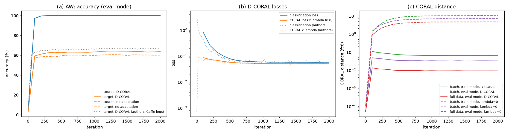
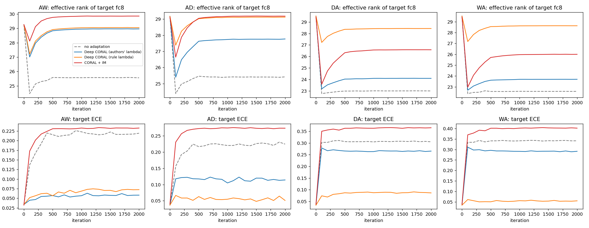
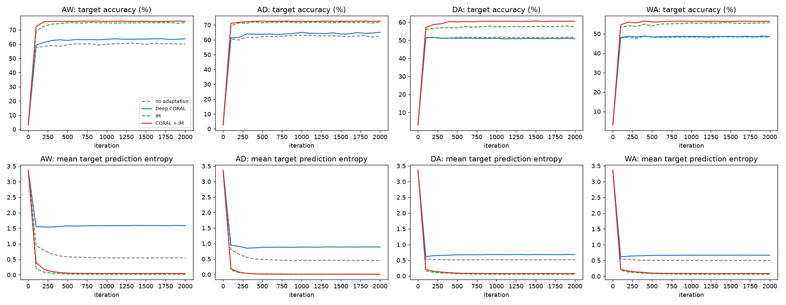
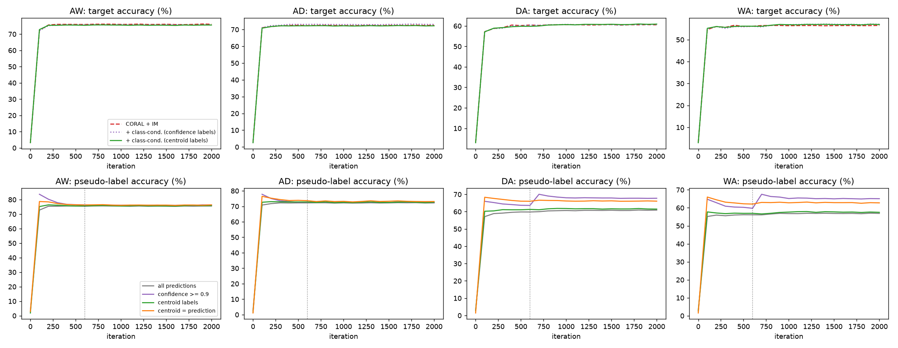

# Deep CORAL 复现与改进报告

## 摘要

在 Office-31 上复现了 Deep CORAL（Sun & Saenko, 2016），并在复现的基础上检验了它的隐含假设、尝试了三个改进，共 239 次训练。

- **复现**：第一次用 torchvision AlexNet 复现时，无适应基线 6 个任务平均只有 63.5%，比论文低 6.6 个点。从原作者仓库拿到了 Caffe 配置和训练日志，逐项对齐后，基线达到 69.4%（论文 70.1%），Deep CORAL 达到 70.3%（论文 72.1%）。Deep CORAL 的配对增益为 +1.0 [+0.3, +1.6]，显著为正，但只有论文 +2.0 的一半。第一次的差距几乎全部来自预训练骨干（−8.2）。
- **诊断**：论文“训练结束时两项损失相等”的 λ 选择规则解不唯一，用它选出的 λ 会让 D→A 掉 6.4 个点；不用目标标签的指标也选不出合适的 λ。训练中的 batch CORAL 损失是真实域距离的 3–7 倍，后期主要在优化估计噪声。λ 过大时特征的有效秩不降反升，与论文“退化特征”的说法不符。
- **改进**：加入目标域信息最大化（IM）后，在 A→W、A→D、D→A、W→A 四个任务上平均比 Deep CORAL 高 9.0 个点 [+6.4, +11.5]，四个任务都显著。增益几乎都来自 IM 本身，CORAL 在其上只再贡献 +1.4。两种基于伪标签的类条件 CORAL 都没有额外提升；诊断表明 IM 之后，从模型自身得到的伪标签已带不来新信息。

## 1. 背景

Deep CORAL 在网络的最后一层（fc8，31 维 logits）上，让源域和目标域特征的协方差矩阵相互靠近：

$$\mathcal{L}_{CORAL} = \frac{1}{4d^2}\lVert C_S - C_T\rVert_F^2,\qquad \mathcal{L} = \mathcal{L}_{cls} + \lambda\,\mathcal{L}_{CORAL}$$

其中协方差在每个 batch 内估计，λ 按“训练结束时分类损失与 CORAL 损失大致相等”来选。我们把方法的有效性拆成四个隐含假设，后文逐一检验：

| 编号 | 隐含假设 | 检验结果 |
|---|---|---|
| A1 | 二阶统计量足以刻画域差异 | 部分不成立：只用 IM、不对齐任何统计量，就比 Deep CORAL 高 7.5 个点 |
| A2 | 只对齐边缘分布即可，无需类别信息 | 无法用伪标签补上：伪标签来自模型自身，类条件对齐没有额外提升 |
| A3 | batch 内协方差能可靠估计总体协方差 | 不成立：batch 损失是真实距离的 3–7 倍 |
| A4 | λ 可以在没有目标标签时设定 | 不成立：规则选出的 λ 让 D→A −6.4，无标签指标都选不出合适的 λ |

## 2. 实验设置

**数据**：Office-31 的 Amazon（2817 张）、DSLR（498 张）、Webcam（795 张）三个域，31 类，6 个迁移任务。按无监督域适应的标准协议，使用全部有标签源域和全部无标签目标域训练，在全部目标域图像上测试，报告第 2000 次迭代的准确率。

**与原作者对齐的训练设置**：

| 项目 | 原作者（Caffe） | 第一次复现 | 最终复现 |
|---|---|---|---|
| 网络与权重 | BVLC Reference CaffeNet | torchvision AlexNet | CaffeNet，由官方 caffemodel 转换 |
| 输入预处理 | BGR 减均值，227 裁剪，OpenCV 缩放 | RGB 归一化，224 裁剪，PIL 缩放 | 同原作者 |
| 学习率 | 10⁻³，每 500 步 ×0.1 | 10⁻³ 固定 | 同原作者 |
| SGD 动量 | 学习率乘进动量 | PyTorch 写法 | 同原作者 |
| epoch 末尾不满一个 batch | 接到下一轮 | 丢弃 | 同原作者 |
| 测试 | 中心裁剪 + 随机翻转 | 中心裁剪 | 同原作者 |
| λ | 每任务单独设定（0.0001–0.8） | — | 原作者 λ；另做无标签规则对照 |

其余设置与论文一致：fc8 为 31 维、N(0, 0.005) 初始化、学习率 ×10；偏置学习率 ×2、不做权重衰减；源域、目标域各 128 张；动量 0.9，权重衰减 5×10⁻⁴，2000 次迭代。

**统计**：阶段一每个配置 5 个种子，改进实验 3 个种子。同一种子下各方法的 fc8 初始化、数据顺序、数据增强和 Dropout 掩码完全相同，所以增益都用同种子配对差值，给出 95% 置信区间（t 分布）；区间跨 0 视为不显著。改进实验的超参数全部事先固定，不用目标标签挑选。

## 3. 复现

### 3.1 第一次复现与差距排查

第一次复现使用 torchvision 的 ImageNet 预训练 AlexNet，无适应基线 6 个任务平均 63.5%，比论文低 6.6 个点。训练日志显示，目标域准确率在第 100 步就到了最终水平，之后基本不变，所以差距不在训练时长或调度，而在预训练网络和输入处理。

原作者在 VisionLearningGroup/CORAL 仓库公开了 D-CORAL_Office31：Caffe 网络定义、求解器配置，以及 6 个任务 × 5 次运行的训练日志。这些日志的最后一轮平均值与论文表 1 的 D-CORAL 一栏完全一致，说明论文报告的是最后一轮。原作者的 CORAL 损失层与我们的实现相同（无偏协方差、除以 4d²），所以他们的 λ 可以直接使用。

### 3.2 Table 1

| 方法 | A→D | A→W | D→A | D→W | W→A | W→D | 平均 |
|---|---|---|---|---|---|---|---|
| CNN（论文） | 63.8 | 61.6 | 51.1 | 95.4 | 49.8 | 99.0 | 70.1 |
| CNN（复现） | 62.6 ± 0.2 | 60.2 ± 1.2 | 51.6 ± 0.9 | 94.8 ± 0.3 | 48.3 ± 0.7 | 98.7 ± 0.6 | 69.4 |
| D-CORAL（论文） | 66.8 | 66.4 | 52.8 | 95.7 | 51.5 | 99.2 | 72.1 |
| D-CORAL（复现） | 65.0 ± 1.5 | 63.7 ± 1.4 | 50.9 ± 0.8 | 94.7 ± 0.3 | 48.6 ± 0.8 | 99.0 ± 0.5 | 70.3 |
| 原作者 λ | 0.05 | 0.8 | 0.001 | 0.0001 | 0.0007 | 0.0001 | |

复现为 5 个种子的均值 ± 标准差（%）。

配对增益（D-CORAL − CNN）：

| | A→D | A→W | D→A | D→W | W→A | W→D | 平均 |
|---|---|---|---|---|---|---|---|
| 论文 | +3.0 | +4.8 | +1.7 | +0.3 | +1.7 | +0.2 | +2.0 |
| 复现 | +2.4 | +3.6 | −0.7 | −0.1 | +0.3 | +0.4 | +1.0 |
| 95% CI | [+0.4, +4.4] | [+2.1, +5.0] | [−1.0, −0.3] | [−0.5, +0.3] | [−0.2, +0.7] | [+0.0, +0.7] | [+0.3, +1.6] |

按方案的验收标准：基线与论文相差 −0.8，在 ±2 以内，通过；A→W、A→D 的增益为正，与论文方向一致；6 任务平均增益 +1.0，比论文 +2.0 低 1.0，刚好落在 ±1 的边界外。D→W 与 W→A 的增益不显著；D→A 显著为负，但原作者在该任务上的 λ 只有 0.001，CORAL 的作用本来就很小。

### 3.3 差距归因

在最终配置上，每次只把一项换回第一次复现的做法，跑无适应基线（A→W、A→D、D→A、W→A 四任务平均，%）：

| 设置 | A→D | A→W | D→A | W→A | 平均 | 与最终配置的差 |
|---|---|---|---|---|---|---|
| 最终配置 | 62.6 | 60.2 | 51.6 | 48.3 | 55.7 | — |
| 只换固定学习率 | 61.6 | 58.0 | 51.3 | 48.4 | 54.8 | −0.9 |
| 只换 torchvision 骨干 | 55.0 | 52.6 | 42.1 | 40.4 | 47.5 | −8.2 |
| 全部换回第一次复现 | 55.9 | 51.1 | 41.2 | 40.8 | 47.3 | −8.4 |

“只换”两组每组 1 个种子，其余 5 个种子。第一次复现的差距几乎全部来自预训练骨干；训练调度的影响不到 1 个点。

### 3.4 与原作者训练日志的对比

上图复现论文图 2：(a) 准确率，(b) 两项损失，(c) CORAL 距离；灰色虚线为原作者日志。两项损失的量级和走势与原作者几乎重合；不加 CORAL 时全量 CORAL 距离从 5×10⁻⁵ 增长到 4.6，结束时是 Deep CORAL 的约 500 倍，与论文的定性结论一致。

目标域准确率（%）：

| | A→D | A→W | D→A | D→W | W→A | W→D |
|---|---|---|---|---|---|---|
| 原作者，第 100 步 | 63.2 | 62.7 | 52.3 | 94.0 | 50.3 | 98.0 |
| 复现，第 100 步 | 61.3 | 59.3 | 51.4 | 93.9 | 48.1 | 98.4 |
| 原作者，最后一轮 | 66.8 | 66.4 | 52.8 | 95.7 | 51.5 | 99.2 |
| 复现，最后一轮 | 65.0 | 63.7 | 50.9 | 94.7 | 48.6 | 99.0 |

在 Amazon 作源域的任务上，差距从第 100 步就存在、之后不再扩大，更可能来自图片解码与缩放等像素级差异，而不是训练过程。

### 3.5 λ 的选择（A4）

论文用“训练结束时两项损失大致相等”选 λ。我们从 λ = 1 出发按这条规则标定（只用源域标签和损失值），与原作者的 λ 对比：

| 任务 | 原作者 λ | 规则 λ* | 增益（原作者 λ） | 增益（规则 λ*） | 增益（共用 A→W 的 λ*） |
|---|---|---|---|---|---|
| A→D | 0.05 | 1.12 | +2.4 | −0.1 | +0.2 |
| A→W | 0.8 | 1.10 | +3.6 | +3.4 | — |
| D→A | 0.001 | 0.63 | −0.7 | −6.4 | −7.7 |
| D→W | 0.0001 | 0.62 | −0.1 | −2.5 | −2.7 |
| W→A | 0.0007 | 0.65 | +0.3 | −1.0 | −1.3 |
| W→D | 0.0001 | 0.66 | +0.4 | ±0.0 | +0.0 |

原作者的 λ 在训练结束时同样满足两项损失大致相等，但取值相差 8000 倍；规则从 λ = 1 出发，得到的 λ* 都在 0.6–1.1。这说明这条规则的解不唯一，取决于从哪里开始标定。在 DSLR、Webcam 作源域时，规则 λ* 比原作者大几百到几千倍，增益全部变差。

## 4. 诊断

以下分析只用已有训练日志，不需要新实验，详见 [offline_analysis/results/offline_summary.md](offline_analysis/results/offline_summary.md)。

### 4.1 停在哪一步

用目标标签挑出的最优迭代只比最后一轮高 0.3–1.1 个点（CNN +0.9，Deep CORAL +0.8，CORAL + IM +0.4）。三种无标签选点规则（最小预测熵、最大 SND、最小全量 CORAL 距离）都不比最后一轮更好；“最小 CORAL 距离”对基线和 IM 会选到第 100 步左右，最差。论文报告最后一轮是合理的。

### 4.2 不用目标标签能否选出 λ 和方法

在 λ = 0、原作者 λ、规则 λ、共用 λ 四个候选中，对每个任务、每个种子按无标签指标挑一个（30 次）：

| 挑选规则 | 最常选中 | 平均准确率 | 遗憾值 |
|---|---|---|---|
| 最小预测熵 | λ = 0（29 / 30 次） | 69.4 | 1.2 |
| 最大 SND | λ = 0（21 / 30 次） | 68.6 | 1.9 |
| 最小 CORAL 距离 | 最大的 λ（30 / 30 次） | 68.0 | 2.6 |
| 固定用原作者 λ | — | 70.3 | 0.2 |

遗憾值为每次候选中的最高准确率减去选中的准确率。每个指标都偏向“直接优化它”的选项：CORAL 会提高预测熵，所以熵最小总是选 λ = 0；CORAL 距离就是 CORAL 优化的量，所以总选最大的 λ。在方法之间挑选时也一样：熵和 SND 偏向 IM 类方法，结果（65.1–65.2）反而不如固定用 CORAL + IM（66.4）。这是 A4 不成立的直接证据，也是我们事先固定所有超参数的原因。

### 4.3 batch 上对齐了，不等于整个域对齐了（A3）

| 任务 | 训练 batch 损失 ÷ 全量距离（CNN） | 同左（Deep CORAL） |
|---|---|---|
| A→D | 2.7 | 7.1 |
| A→W | 2.2 | 7.0 |
| D→A | 1.5 | 3.3 |
| D→W | 2.4 | 3.2 |
| W→A | 1.6 | 3.1 |
| W→D | 2.5 | 3.5 |

以 A→W 为例，Deep CORAL 训练中看到的 batch CORAL 损失是 0.064，用全部图像算出的真实距离只有 0.009。放大来自两部分：有限样本估计协方差本身偏大（评估模式下 batch 距离是全量距离的 1.3–3.7 倍），训练模式的 Dropout 再放大 1.2–2.0 倍。真实距离越小，估计偏差占比越大，所以 CORAL 生效后，训练后期最小化的主要是估计噪声；论文图 2(b) 中“两项损失相等”，比较的其实是分类损失和一个以噪声为主的量。

### 4.4 λ 过大时特征并没有“退化”

论文把 λ 过大时的掉点归因于“退化特征”。若成立，λ 越大，有效秩应越低。目标域 fc8 的有效秩（最大 31）与准确率：

| 任务 | CNN | 原作者 λ | 规则 λ* |
|---|---|---|---|
| D→A | 23.0，51.6% | 24.1，50.9% | 28.4，45.2% |
| D→W | 23.1，94.8% | 23.5，94.7% | 29.0，92.3% |
| W→A | 22.6，48.3% | 23.7，48.6% | 28.6，47.4% |
| W→D | 23.3，98.7% | 23.7，99.0% | 29.5，98.7% |

λ 增大几百到几千倍后，有效秩升高、准确率下降，fc7 的有效秩基本不变。我们的解释是：CORAL 让目标 logits 的协方差去匹配源域；源域在训练集上被完美分开，31 类各自散开，协方差谱接近均匀。λ 太大时，这种结构被硬套到不具备它的目标特征上，目标预测变得更分散、更不确定（预测熵从 0.95 升到 1.68），而不是塌缩。

### 4.5 校准性

A→W、A→D、D→A、W→A 四任务、种子 1–3 平均：

| 方法 | 准确率 % | ECE | NLL | 平均预测熵 |
|---|---|---|---|---|
| CNN | 55.9 | 0.273 | 2.63 | 0.50 |
| Deep CORAL（原作者 λ） | 57.5 | 0.181 | 2.03 | 0.95 |
| Deep CORAL（规则 λ） | 54.9 | 0.066 | 1.75 | 1.68 |
| IM | 65.0 | 0.336 | 8.12 | 0.04 |
| CORAL + IM | 66.4 | 0.318 | 4.18 | 0.05 |

CORAL 明显改善校准，λ 越大越明显，但准确率可能下降。IM 正好相反：准确率大幅提高，NLL 却高达 8.1，说明错误的预测也非常自信。把 CORAL 加到 IM 上，准确率只多 1.4 个点，NLL 却减半。

## 5. 改进

### 5.1 设计原则

- 每个改进只针对一处弱点，超参数事先固定，不用目标标签挑选。
- CORAL 的 λ 统一用原作者取值；对照组复用之前同种子的运行，配对比较。
- 只跑 A→W、A→D、D→A、W→A 四个任务、3 个种子；D→W、W→D 已接近 99%，没有提升空间。
- 新的损失项在启用之前，与同种子的对照运行逐位相同（已在假数据上核对）。

### 5.2 改进 1：目标域信息最大化

Deep CORAL 只对齐统计量，完全不利用目标域自身的结构。信息最大化在目标域上加两项损失，权重都取 β = 0.3：

- **单样本熵**：每个目标样本预测分布的熵，越小预测越确定，决策边界越远离样本密集区；
- **多样性**：batch 平均预测分布的负熵，越小各类别被预测得越均匀，防止所有样本塌到少数类。

目标域准确率（%，3 个种子）：

| 任务 | CNN | Deep CORAL | IM | CORAL + IM | CORAL + IM − Deep CORAL |
|---|---|---|---|---|---|
| A→W | 60.5 | 64.3 | 75.1 | 76.1 | +11.8 [+7.1, +16.6] |
| A→D | 62.6 | 65.7 | 71.7 | 72.6 | +6.9 [+3.7, +10.1] |
| D→A | 51.7 | 51.1 | 57.4 | 60.5 | +9.4 [+8.0, +10.8] |
| W→A | 48.6 | 48.8 | 55.7 | 56.5 | +7.7 [+0.3, +15.1] |
| 平均 | 55.9 | 57.5 | 65.0 | 66.4 | +9.0 [+6.4, +11.5] |

拆开看：只加 IM 就比 CNN 高 +9.1 [+7.5, +10.7]；在 IM 上再加 CORAL，只多 +1.4 [−0.8, +3.7]，四个任务中只有 D→A 显著（+3.1）。Deep CORAL 的瓶颈不在二阶统计量对齐得够不够，而在没有利用目标域结构。

**多样性项必不可少**（种子 1）：去掉它、只做熵最小化，预测塌到少数类上。

| 任务 | 只做熵最小化 | CORAL + IM |
|---|---|---|
| A→W | 4.2%（2 类） | 75.7%（31 类） |
| A→D | 16.5%（17 类） | 72.1%（31 类） |
| D→A | 3.5%（2 类） | 59.8%（31 类） |
| W→A | 3.9%（9 类） | 59.4%（31 类） |

括号内为目标预测覆盖的类别数。

**结果对 β 不敏感**（CORAL + IM，种子 1，%）：

| 任务 | Deep CORAL | β = 0.1 | β = 0.3 | β = 1 |
|---|---|---|---|---|
| A→W | 63.3 | 78.0 | 75.7 | 70.2 |
| A→D | 64.3 | 70.7 | 72.1 | 70.5 |
| D→A | 51.0 | 60.6 | 59.8 | 59.1 |
| W→A | 48.3 | 57.6 | 59.4 | 55.5 |

β 在 0.1–1 之间都比 Deep CORAL 高 6–15 个点；这张表只说明敏感程度，不用来挑 β。

### 5.3 改进 2：类条件 CORAL（置信度伪标签）

针对 A2，在 CORAL + IM 之上按类别对齐 fc8 特征的均值和协方差（γ = 0.3，第 600 步启用）。源域用真实标签，目标域用当前 batch 预测中置信度 ≥ 0.9 的样本作伪标签。batch 128、31 类时每类平均只有约 4 个样本，所以每个域、每个类维护 32 个样本的特征队列，与当前 batch 合起来估计，梯度只回传到当前 batch。

| 任务 | CORAL + IM | + 类条件 | 变化 |
|---|---|---|---|
| A→W | 76.1 | 75.8 | −0.3 [−1.1, +0.4] |
| A→D | 72.6 | 73.1 | +0.5 [−1.1, +2.1] |
| D→A | 60.5 | 60.6 | +0.1 [−1.7, +1.9] |
| W→A | 56.5 | 57.0 | +0.6 [−0.6, +1.7] |
| 平均 | 66.4 | 66.6 | +0.2 [−0.5, +0.9] |

只对齐类均值、只对齐类协方差，以及 γ 取 0.1 或 1（种子 1）的结果都在 ±2 个点内波动，没有稳定趋势。对齐项本身在起作用：31 个类基本都被计入，类条件损失明显下降（D→A 从 3.17 降到 1.24）。问题在伪标签，见 5.5。

### 5.4 改进 3：类中心伪标签

既然置信度筛不掉错误伪标签，改用不看置信度的标签：每次评估时，用全部目标图像的 fc7 特征，按预测概率加权得到各类中心，把每个样本分给最近的类中心（余弦距离），再用硬标签重算一次中心。其余设置同改进 2。

| 任务 | CORAL + IM | + 类条件（类中心伪标签） | 变化 |
|---|---|---|---|
| A→W | 76.1 | 75.6 | −0.5 |
| A→D | 72.6 | 72.2 | −0.3 |
| D→A | 60.5 | 60.9 | +0.4 |
| W→A | 56.5 | 56.9 | +0.4 |
| 平均 | 66.4 | 66.4 | ±0.0 [−1.1, +1.1] |

消融（种子 1）中，只保留类中心与预测一致的样本，四任务为 75.8 / 72.7 / 61.9 / 59.9；在类中心伪标签上再加自训练（目标样本对伪标签的交叉熵，权重 0.3），为 74.6 / 72.5 / 64.2 / 62.8，在 D→A、W→A 上比 CORAL + IM 高 4.4、3.4 个点，是唯一的正面信号，但只有 1 个种子，A→W 还略有下降，尚未验证。

### 5.5 为什么两种伪标签都没用

最后一轮的伪标签质量（%，用目标标签计算，仅用于分析）：

| 任务 | 通过 0.9 阈值的比例 | 其中正确 | 类中心标签准确率 | 模型预测准确率 | 类中心与预测一致 |
|---|---|---|---|---|---|
| A→W | 98.7 | 76.4 | 75.9 | 75.6 | 98.1 |
| A→D | 99.3 | 73.2 | 72.6 | 72.2 | 98.5 |
| D→A | 84.2 | 67.3 | 61.5 | 60.9 | 88.6 |
| W→A | 80.5 | 64.4 | 57.5 | 56.9 | 86.0 |

前两列来自改进 2 的模型，后三列来自改进 3 的模型，均为 3 个种子平均。

- IM 让模型过度自信，0.9 的阈值几乎筛不掉错误：A→W 上 98.7% 的目标样本通过了阈值，其中约四分之一是错的。
- 类中心标签与模型预测在 Amazon 作源域的任务上有 98% 以上是同一个标签，准确率也几乎相同。IM 训练之后，特征的聚类结构和预测已经互相吻合。
- 伪标签准确率在训练中持平或略升（D→A +3.1、W→A +4.4），没有出现确认偏差。

所以不论用置信度筛选还是在特征空间聚类，伪标签都来自同一个模型，给不出模型不知道的信息。要让类条件对齐生效，需要模型之外的信息来源，例如不同数据增强下预测的一致性，或多个模型的集成。

## 6. 结论

1. 对齐原作者的 Caffe 配置后，复现对上了论文：基线只差 0.8 个点，Deep CORAL 的增益显著为正，但只有论文的一半。第一次复现的差距几乎全部来自预训练骨干。
2. Deep CORAL 的增益依赖 λ，而 λ 在无监督条件下定不下来：论文的规则解不唯一，无标签指标都偏向“直接优化它”的选项（A4）。
3. batch 内的 CORAL 损失以估计噪声为主（A3）；λ 过大时的危害不是特征塌缩，而是把源域的协方差结构硬套到目标特征上。
4. 目标域信息最大化是最有效的改进，平均 +9.0；CORAL 在其上主要起抑制过度自信的作用（NLL 减半），准确率只多 1.4。
5. 补类别信息（A2）需要可靠的伪标签，而 IM 之后从模型自身得到的伪标签已带不来新信息，类条件 CORAL 没有额外提升。

## 7. 局限与下一步

- 改进实验每个配置 3 个种子，消融和敏感性实验只有 1 个种子；W→A 的种子间标准差达 2.5–2.9，单种子差异小于 3 个点时不宜下结论。
- 原作者的 λ 可能参考过目标域结果；我们的改进沿用了这些 λ，但新增的超参数都事先固定。
- 只在 AlexNet 级骨干上实验，没有测试 ResNet 等带 BN 的骨干，也没有做方案中的损失替换（MMD、DANN 等）、对齐层位置和受控合成偏移实验。
- Fisher 比和温度缩放需要逐样本特征和源域验证集，batch 大小对估计误差的影响需要模型权重，都没有做。
- 下一步：用 3 个种子验证自训练；补上述需要特征的分析。

## 结果文件

| 内容 | 位置 |
|---|---|
| 阶段一：复现、λ 标定、差距归因 | [stage1_reproduction/results/stage1_summary.md](stage1_reproduction/results/stage1_summary.md) |
| 阶段二：信息最大化 | [stage2_improvement/results/improve_summary.md](stage2_improvement/results/improve_summary.md) |
| 阶段三：类条件 CORAL | [stage3_class_conditional/results/cc_summary.md](stage3_class_conditional/results/cc_summary.md) |
| 阶段四：类中心伪标签 | [stage4_pseudo_labels/results/pl_summary.md](stage4_pseudo_labels/results/pl_summary.md) |
| 离线分析 | [offline_analysis/results/offline_findings.md](offline_analysis/results/offline_findings.md) |
| 原作者训练日志的参考曲线 | [stage1_reproduction/official_reference.json](stage1_reproduction/official_reference.json) |

运行方法见 [README.md](README.md)。
