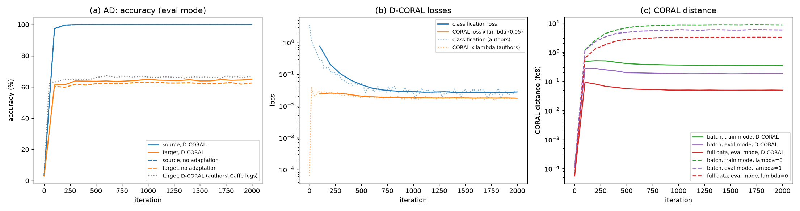
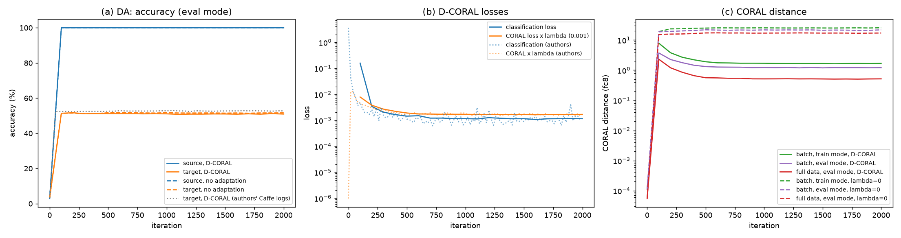
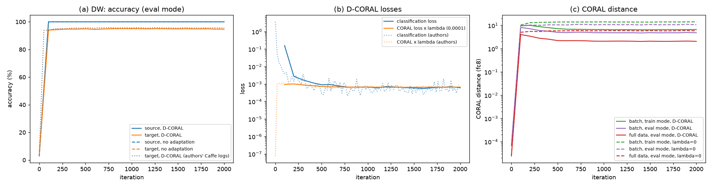
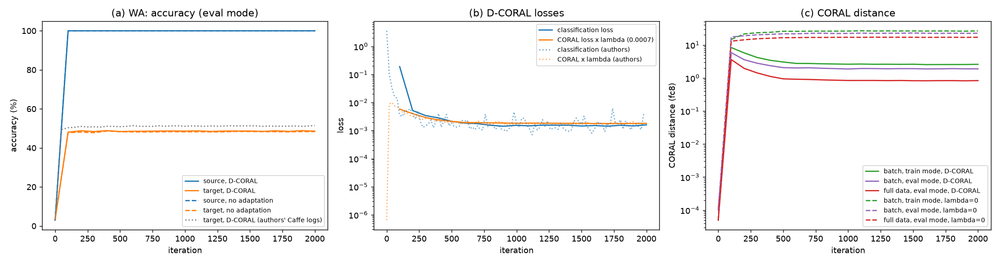
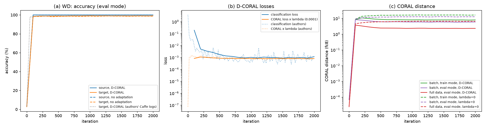

# 阶段一结果汇总

## 主结果（目标域准确率 %，最后一轮；Deep CORAL 使用原作者的 λ）

| 任务 | 原文 CNN | 基线 | 原文 D-CORAL | Deep CORAL | 原文增益 | 配对增益 [95% CI] | 显著 | D-CORAL 最佳一轮（仅参考） | λ |
|---|---|---|---|---|---|---|---|---|---|
| A→D | 63.8 | 62.6 ± 0.2 (5) | 66.8 | 65.0 ± 1.5 (5) | +3.0 | +2.4 [+0.4, +4.4] (5) | 是 | 65.9 ± 1.2 (5) | 0.05 |
| A→W | 61.6 | 60.2 ± 1.2 (5) | 66.4 | 63.7 ± 1.4 (5) | +4.8 | +3.6 [+2.1, +5.0] (5) | 是 | 64.6 ± 0.8 (5) | 0.8 |
| D→A | 51.1 | 51.6 ± 0.9 (5) | 52.8 | 50.9 ± 0.8 (5) | +1.7 | -0.7 [-1.0, -0.3] (5) | 是 | 51.9 ± 0.8 (5) | 0.001 |
| D→W | 95.4 | 94.8 ± 0.3 (5) | 95.7 | 94.7 ± 0.3 (5) | +0.3 | -0.1 [-0.5, +0.3] (5) | 否（跨 0） | 95.6 ± 0.1 (5) | 0.0001 |
| W→A | 49.8 | 48.3 ± 0.7 (5) | 51.5 | 48.6 ± 0.8 (5) | +1.7 | +0.3 [-0.2, +0.7] (5) | 否（跨 0） | 49.4 ± 0.9 (5) | 0.0007 |
| W→D | 99.0 | 98.7 ± 0.6 (5) | 99.2 | 99.0 ± 0.5 (5) | +0.2 | +0.4 [+0.0, +0.7] (5) | 是 | 99.4 ± 0.3 (5) | 0.0001 |
| 平均（6 个任务） | 70.1 | 69.4 | 72.1 | 70.3 | +2.0 | +1.0 [+0.3, +1.6] (5) | 是 | | |

“最佳一轮”是用目标标签挑出的迭代步，相当于用目标标签选模型，只作参考上界。原文表 1 报告的是最后一轮。

## 与原作者训练日志对照（目标域准确率 %）

原作者日志只有 Deep CORAL，没有无适应基线；D→W、W→D 的 λ 只有 0.0001，接近无适应。

| 任务 | 原作者第 100 步 | 我们 D-CORAL 第 100 步 | 我们基线第 100 步 | 原作者最后一轮 | 我们 D-CORAL 最后一轮 |
|---|---|---|---|---|---|
| A→D | 63.2 | 61.3 | 60.4 | 66.8 | 65.0 |
| A→W | 62.7 | 59.3 | 57.7 | 66.4 | 63.7 |
| D→A | 52.3 | 51.4 | 51.4 | 52.8 | 50.9 |
| D→W | 94.0 | 93.9 | 94.1 | 95.7 | 94.7 |
| W→A | 50.3 | 48.1 | 47.8 | 51.5 | 48.6 |
| W→D | 98.0 | 98.4 | 98.3 | 99.2 | 99.0 |

## 验收检查（方案 1.5）

1. 基线：6 个任务平均 69.4，原文对应任务平均 70.1，差 -0.8 → 通过
2. 图 2 现象（A→W，供人工判断）：第 100 步 λ·L_coral / L_cls = 0.109（应远小于 1），结束时 = 0.883（应接近 1）；λ = 0 时全量 CORAL 距离从 5.011e-05 到 4.602e+00（应持续增大），结束时是 Deep CORAL 的 505.7 倍（应显著大于 1）
3. 增益方向：A→W +3.6（为正）；A→D +2.4（为正）
   6 任务平均增益 +1.0，原文 +2.0 → 超出 ±1
4. 增益不显著（95% CI 跨 0）的任务：D→W、W→A

## λ：规则标定（不用目标标签）与原作者取值

| 任务 | 原作者 λ | 规则 λ* | 标定过程：λ → 结束时 L_cls/(λ·L_coral) | 增益（原作者 λ） | 增益（规则 λ*） | 规则 − 原作者 [95% CI] | 显著 |
|---|---|---|---|---|---|---|---|
| A→D | 0.05 | 1.12 | 1.12 → 1.10 | +2.4 [+0.4, +4.4] (5) | -0.1 [-0.9, +0.7] (5) | -2.5 [-5.2, +0.1] (5) | 否（跨 0） |
| A→W | 0.8 | 1.1 | 1.1 → 1.09 | +3.6 [+2.1, +5.0] (5) | +3.4 [+2.5, +4.3] (5) | -0.2 [-1.1, +0.8] (5) | 否（跨 0） |
| D→A | 0.001 | 0.627 | 0.627 → 0.61 | -0.7 [-1.0, -0.3] (5) | -6.4 [-7.4, -5.4] (5) | -5.7 [-6.4, -5.0] (5) | 是 |
| D→W | 0.0001 | 0.616 | 0.616 → 0.60 | -0.1 [-0.5, +0.3] (5) | -2.5 [-3.0, -2.0] (5) | -2.4 [-3.1, -1.6] (5) | 是 |
| W→A | 0.0007 | 0.652 | 0.652 → 0.65 | +0.3 [-0.2, +0.7] (5) | -1.0 [-1.7, -0.2] (5) | -1.2 [-2.4, -0.1] (5) | 是 |
| W→D | 0.0001 | 0.659 | 0.659 → 0.65 | +0.4 [+0.0, +0.7] (5) | -0.0 [-1.0, +1.0] (5) | -0.4 [-1.2, +0.5] (5) | 否（跨 0） |

标定从 λ = 1 出发（方案 1.3）。原作者的 λ 结束时也满足两项损失大致相等，两者不同说明“损失相等”规则的解不唯一，取决于起点。

## 对照：所有任务共用 A→W 的规则 λ*（1.1）

| 任务 | 自身 λ* | 增益（自身 λ*） | 增益（共用 λ） | 共用 − 自身 [95% CI] | 显著 |
|---|---|---|---|---|---|
| A→D | 1.12 | -0.1 [-0.9, +0.7] (5) | +0.2 [-0.6, +1.1] (5) | +0.4 [-0.4, +1.1] (5) | 否（跨 0） |
| D→A | 0.627 | -6.4 [-7.4, -5.4] (5) | -7.7 [-8.9, -6.4] (5) | -1.3 [-2.0, -0.6] (5) | 是 |
| D→W | 0.616 | -2.5 [-3.0, -2.0] (5) | -2.7 [-3.5, -2.0] (5) | -0.2 [-0.8, +0.3] (5) | 否（跨 0） |
| W→A | 0.652 | -1.0 [-1.7, -0.2] (5) | -1.3 [-2.4, -0.2] (5) | -0.3 [-0.7, -0.0] (5) | 是 |
| W→D | 0.659 | -0.0 [-1.0, +1.0] (5) | +0.0 [-0.9, +1.0] (5) | +0.0 [-0.1, +0.2] (5) | 否（跨 0） |

## 差距归因：在原文配置上每次只改一项（无适应基线，目标准确率 %）

| 任务 | 原文 CNN | 原文配置 | 固定学习率 | torchvision 骨干 | 全部 torchvision 风格 |
|---|---|---|---|---|---|
| A→D | 63.8 | 62.6 ± 0.2 (5) | 61.6 ± — (1)，-1.2 | 55.0 ± — (1)，-7.8 | 55.9 ± 1.0 (5)，-6.7 |
| A→W | 61.6 | 60.2 ± 1.2 (5) | 58.0 ± — (1)，-2.8 | 52.6 ± — (1)，-8.2 | 51.1 ± 2.7 (5)，-9.0 |
| D→A | 51.1 | 51.6 ± 0.9 (5) | 51.3 ± — (1)，-0.5 | 42.1 ± — (1)，-9.7 | 41.2 ± 1.5 (5)，-10.5 |
| W→A | 49.8 | 48.3 ± 0.7 (5) | 48.4 ± — (1)，-0.1 | 40.4 ± — (1)，-8.1 | 40.8 ± 0.3 (5)，-7.5 |
| 平均（4 个任务） | 56.6 | 55.7 | 54.8，-0.9 | 47.5，-8.2 | 47.3，-8.4 |

每格为“均值 ± 标准差（种子数），与原文配置同种子配对的差值”。“全部 torchvision 风格”即最初那版设置（torchvision AlexNet、224、PIL 缩放、固定学习率、PyTorch SGD、丢弃 epoch 剩余样本、测试不翻转）。

## 图 2 复现（种子均值，灰色虚线为原作者日志）

