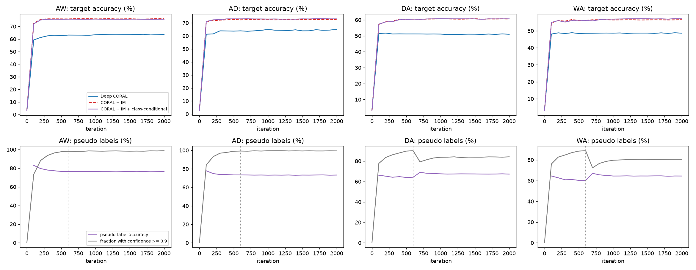

# 阶段三 改进 2：类条件 CORAL

## 主结果（目标域准确率 %，最后一轮；γ = 0.3）

各方法只统计共有的种子，配对差值按同种子计算。基线、Deep CORAL 来自阶段一，CORAL + IM 来自阶段二。

| 任务 | 基线 | Deep CORAL | CORAL + IM | CORAL + IM + 类条件 | 类条件 − (CORAL+IM) | 类条件 − Deep CORAL | 伪标签占比 / 准确率 |
|---|---|---|---|---|---|---|---|
| A→W | 60.5 ± 0.2 (3) | 64.3 ± 1.4 (3) | 76.1 ± 0.8 (3) | 75.8 ± 0.6 (3) | -0.3 [-1.1, +0.4] (3)，不显著 | +11.5 [+7.5, +15.5] (3) | 98.7 / 76.4 |
| A→D | 62.6 ± 0.2 (3) | 65.7 ± 1.5 (3) | 72.6 ± 2.0 (3) | 73.1 ± 1.3 (3) | +0.5 [-1.1, +2.1] (3)，不显著 | +7.4 [+4.7, +10.2] (3) | 99.3 / 73.2 |
| D→A | 51.7 ± 0.2 (3) | 51.1 ± 0.1 (3) | 60.5 ± 0.7 (3) | 60.6 ± 0.0 (3) | +0.1 [-1.7, +1.9] (3)，不显著 | +9.5 [+9.1, +9.9] (3) | 84.2 / 67.3 |
| W→A | 48.6 ± 0.3 (3) | 48.8 ± 0.7 (3) | 56.5 ± 2.5 (3) | 57.0 ± 2.9 (3) | +0.6 [-0.6, +1.7] (3)，不显著 | +8.3 [-0.1, +16.7] (3)，不显著 | 80.5 / 64.4 |
| 平均（4 个任务） | 55.9 | 57.5 | 66.4 | 66.6 | +0.2 [-0.5, +0.9] (3) | +9.2 [+5.9, +12.4] (3) | |

“不显著”指 95% 置信区间跨 0。伪标签占比 / 准确率：最后一轮评估时置信度 ≥ 0.9 的目标样本占全部目标样本的比例，以及这些样本的预测准确率（用目标标签计算，仅用于分析）。

## 伪标签质量随训练的变化（CORAL + IM + 类条件，种子均值，%）

| 任务 | 启用时占比 / 准确率 | 最后一轮占比 / 准确率 | 准确率变化 |
|---|---|---|---|
| A→W | 97.7 / 76.4 | 98.7 / 76.4 | -0.1 |
| A→D | 99.0 / 73.3 | 99.3 / 73.2 | -0.1 |
| D→A | 89.8 / 64.2 | 84.2 / 67.3 | +3.1 |
| W→A | 88.5 / 60.1 | 80.5 / 64.4 | +4.4 |

第 600 步是类条件对齐开始启用的时刻。准确率下降说明伪标签错误被不断强化（确认偏差）。

## 消融：类条件项对齐什么（种子 1，目标域准确率 %）

| 任务 | CORAL + IM | + 只对齐类均值 | + 只对齐类协方差 | + 均值和协方差 |
|---|---|---|---|---|
| A→W | 75.7 | 75.0 | 75.1 | 75.2 |
| A→D | 72.1 | 72.3 | 70.7 | 72.9 |
| D→A | 59.8 | 61.1 | 61.6 | 60.6 |
| W→A | 59.4 | 57.3 | 60.1 | 60.3 |

三种类条件变体都加在 CORAL + IM 之上，γ = 0.3。

## γ 敏感性（种子 1，目标域准确率 %）

| 任务 | CORAL + IM（γ = 0） | γ = 0.1 | γ = 0.3 | γ = 1 |
|---|---|---|---|---|
| A→W | 75.7 | 75.0 | 75.2 | 75.0 |
| A→D | 72.1 | 69.7 | 72.9 | 71.3 |
| D→A | 59.8 | 60.9 | 60.6 | 61.4 |
| W→A | 59.4 | 59.1 | 60.3 | 58.1 |

γ = 0.3 是事先定好的主设置；这张表只说明结果对 γ 的敏感程度，不用来挑 γ。

## 训练曲线（种子均值；灰色虚线为类条件对齐开始的第 600 步）

